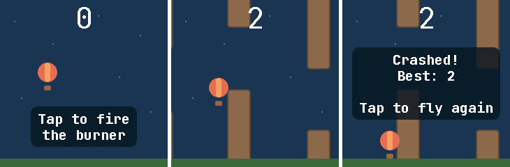
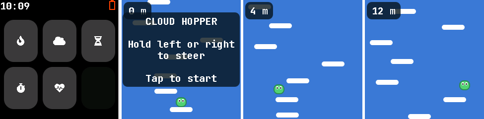

# Sky Games for InfiniTime

Two small arcade games for the [PineTime](https://pine64.org/devices/pinetime/) running
[InfiniTime](https://github.com/InfiniTimeOrg/InfiniTime), packaged with an `infinitime-app.json`
manifest so InfiniTime Builder can add them to your firmware — no fork needed.

## Hot Air

Tap anywhere to fire the burner and lift your balloon; let go and it sinks. Drift through the
gaps between the rock pillars — the gaps get tighter the further you fly.

## Cloud Hopper

Your jelly blob bounces automatically from cloud to cloud. **Hold the left or right half** of the
screen to steer, and fly off one side to come back on the other. Climb as high as you can:

- white clouds are solid,
- blue clouds drift sideways,
- grey clouds puff away after one bounce.

## Controls (both games)

| | |
|---|---|
| Tap / hold | play |
| Button | leave the game |

Swipes are ignored while a game is running so that a hurried tap doesn't close it. Your best
score is kept until the watch restarts. The screen stays on while you play.

## Install

1. Open **InfiniTime Builder**, go to **Sources** and add `ScanuNicco/infinitime-sky-games`
   (or find it with *Find apps on GitHub*).
2. Switch **Hot Air** and/or **Cloud Hopper** on in **Apps**. They take about 2.3 KB and 2.6 KB of
   flash respectively.
3. Build and install the firmware.

Requires InfiniTime 1.16 or later. Tested on 1.16.1 in the
[InfiniEmu](https://github.com/pipe01/InfiniEmu) emulator.

## For developers

Each game is a normal InfiniTime `Screen` with an `AppTraits` specialisation in its header,
declared in [`infinitime-app.json`](infinitime-app.json). Notes:

- Physics uses fixed-point integers (1/256 px) and advances in fixed 20 ms steps measured with
  the LVGL clock, so the games run at the same speed however long a frame takes to draw.
- Touches are read with `OnTouchEvent(x, y)`, which fires continuously while the finger is down:
  a gap of more than 80 ms starts a new press. The `Tap` gesture is a backup for very short taps.

## License

GPL-3.0, like InfiniTime.
